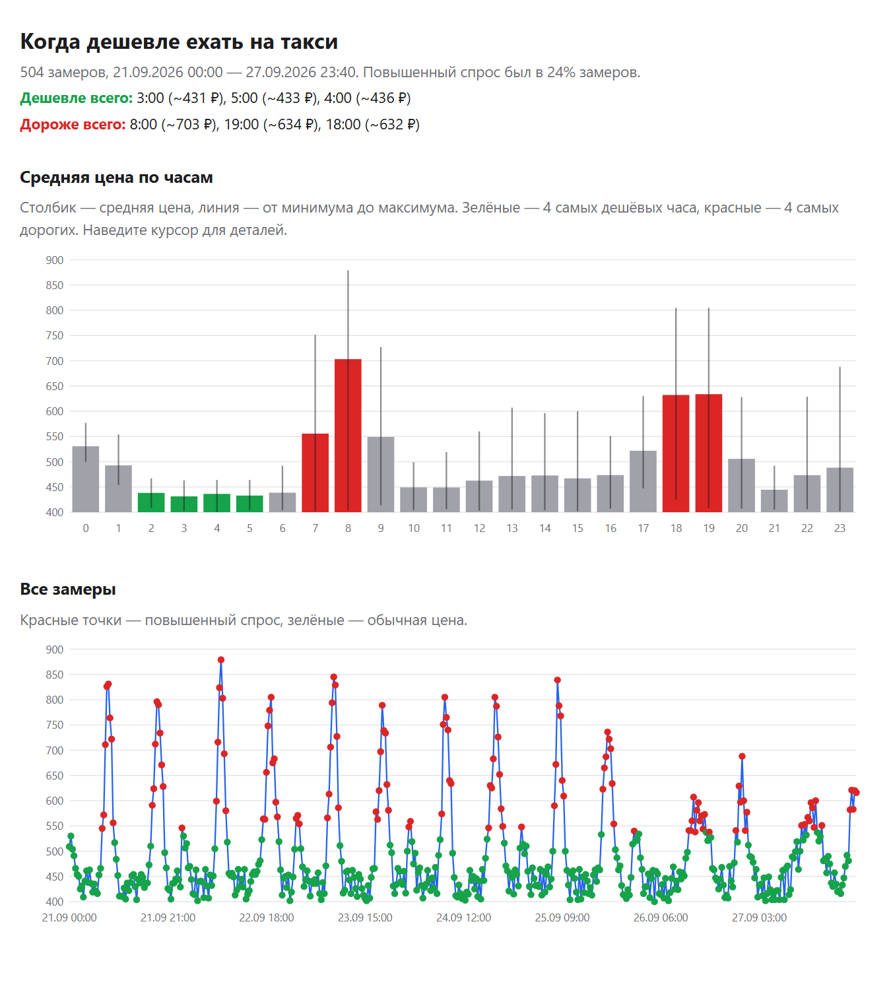

# TaxiPriceTracker

Скрипт раз в 20 минут узнаёт цену поездки на Яндекс Такси (тариф «Эконом»)
и дописывает её в `taxi_prices.csv`. Так можно увидеть, как цена меняется
в течение дня и когда включается повышенный спрос.

Цена берётся со страницы маршрута в Яндекс Картах. Вход в аккаунт и API-ключи не нужны.

Маршрут задаётся при запуске — координатами начала и конца, в коде он не хранится.

По собранным данным строятся графики: средняя цена по часам и все замеры во времени —
сразу видно, в какое время ехать дешевле.



*Пример отчёта на выдуманных данных: Москва, неделя замеров каждые 20 минут.*

## Файлы

| Файл | Назначение |
|---|---|
| `taxi_price.py` | сбор цен в `taxi_prices.csv` |
| `taxi_report.py` | отчёт с графиками в `taxi_report.html` |
| `taxi_live.py` | живой график в браузере, обновляется сам |
| `start.bat` | запуск сбора цен и живого графика двойным щелчком (Windows) |

## Требования

- **Python 3.8+** — https://www.python.org/downloads/
  (при установке на Windows отметьте **«Add Python to PATH»**).
- Сторонние библиотеки не нужны: используется только стандартная библиотека.

## Запуск

Маршрут — две точки в формате `широта,долгота`: откуда и куда.
Чтобы узнать координаты места: правый клик по нему в Яндекс Картах → «Что здесь?».

**Windows:** дважды щёлкните `start.bat` — скрипт спросит координаты, а в отдельном окне
запустится живой график. Маршрут можно передать и сразу:
`start.bat 55.752023,37.617499 55.749633,37.537434`.

**Любая ОС:**

```bash
# замер каждые 20 минут, пока окно открыто
python taxi_price.py 55.752023,37.617499 55.749633,37.537434

# один замер и выход (для планировщика)
python taxi_price.py 55.752023,37.617499 55.749633,37.537434 --once

# без координат — скрипт спросит их сам
python taxi_price.py
```

Город указывать не нужно: Яндекс определяет его по координатам.

В консоли будут появляться строки вида:

```
2026-09-30 21:32  174 ₽  подача 6 мин  (повышенный спрос)
```

Остановить: **Ctrl+C** или закрыть окно. Компьютер не должен уходить в сон.

## Результаты

Замеры сохраняются в `taxi_prices.csv` рядом со скриптом
(кодировка UTF-8 с BOM, разделитель `;` — файл сразу открывается в Excel).

| Колонка | Что значит |
|---|---|
| время | дата и время замера |
| цена_руб | цена поездки в рублях |
| подача_мин | через сколько минут приедет машина |
| в_пути_мин | время в пути |
| повышенный_спрос | «да», если действует повышенный коэффициент |
| ошибка | заполняется, если цену получить не удалось |

Пример — [`docs/example_prices.csv`](docs/example_prices.csv) (выдуманные данные по Москве
за неделю, по ним построен скриншот выше):

```
время;цена_руб;подача_мин;в_пути_мин;повышенный_спрос;ошибка
2026-09-22 07:40;716;5;24;да;
2026-09-22 08:00;824;9;26;да;
2026-09-22 08:20;879;6;28;да;
2026-09-24 03:20;;;;;Яндекс показал капчу
2026-09-24 03:40;428;5;17;нет;
```

Чтобы посмотреть графики без сбора цен, скопируйте пример на место `taxi_prices.csv`
и запустите `python taxi_live.py` (свой `taxi_prices.csv`, если он есть, сначала сохраните).

## Графики

Скрипты графиков только читают `taxi_prices.csv` и не мешают сбору цен —
их можно запускать в соседнем окне терминала, пока работает `taxi_price.py`.

**Живой график** — локальный сервер, страница обновляется сама после каждого нового замера
(проверка раз в 30 секунд):

```bash
python taxi_live.py         # откроется http://localhost:8000
python taxi_live.py 8080    # если порт 8000 занят
```

**Отчёт в файл** — `taxi_report.html`, открывается в любом браузере:

```bash
python taxi_report.py            # построить отчёт и открыть его
python taxi_report.py --watch    # пересобирать отчёт при каждом новом замере
```

Кроме того, `taxi_price.py` сам обновляет `taxi_report.html` после каждого замера.

На графиках:

- **Средняя цена по часам** — столбик показывает среднее, линия — разброс от минимума
  до максимума. Зелёным отмечены 4 самых дешёвых часа, красным — 4 самых дорогих.
- **Все замеры** — цена во времени; красные точки — повышенный спрос.

Наведите курсор на столбик или точку, чтобы увидеть точные цифры.
Остановить любой из скриптов: **Ctrl+C**.

## Настройки

В начале `taxi_price.py`:

- `INTERVAL_MIN` — интервал между замерами в минутах.

## Запуск без открытого окна (Планировщик заданий Windows)

1. Откройте **Планировщик заданий** → **«Создать простую задачу»**, триггер **«Ежедневно»**.
2. Действие **«Запустить программу»**:
   - Программа: `python`
   - Аргументы: `taxi_price.py <откуда> <куда> --once`,
     например `taxi_price.py 55.752023,37.617499 55.749633,37.537434 --once`
   - Рабочая папка: путь к папке со скриптом
3. В свойствах задачи → **«Триггеры»** → «Изменить» → **«Повторять задачу каждые: 20 мин»**
   в течение **«Бесконечно»**.

На Linux/macOS то же самое делается через cron:

```
*/20 * * * * cd /path/to/TaxiPriceTracker && python3 taxi_price.py 55.752023,37.617499 55.749633,37.537434 --once
```

## Возможные проблемы

- **`python` не найден** — переустановите Python с галочкой «Add Python to PATH».
- **В колонке «ошибка»: «капча» или «цена не найдена»** — Яндекс временно ограничил
  запросы или изменил разметку страницы. Скрипт продолжит попытки сам; если ошибка
  держится постоянно, парсер нужно обновить.
- Цена на странице Карт может отличаться от цены в приложении на несколько рублей.

## Дисклеймер

Проект не связан с Яндексом. Данные берутся с публичной страницы Яндекс Карт;
используйте скрипт умеренно и в соответствии с условиями использования сервиса.
